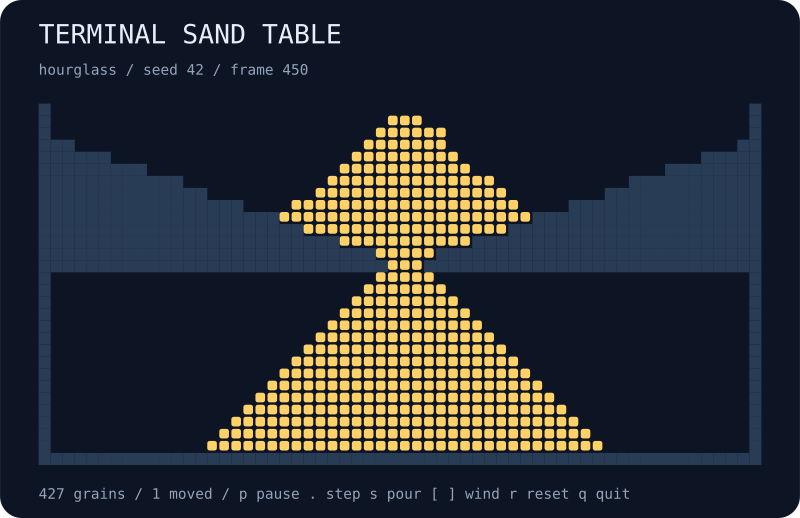

# terminal-sand-table

A falling-sand playground in your terminal. Fill an hourglass, build dunes, pause a cascade, or bias the grains toward one side.



## Run

```bash
npx --yes github:b69ca/terminal-sand-table
npx --yes github:b69ca/terminal-sand-table --preset dunes
```

Node.js 20 or newer. No runtime dependencies. Everything runs locally.

## Play

| Key | Action |
| --- | --- |
| `p` or Space | Pause / resume |
| `.` | Pause and advance one step |
| `s` | Toggle pouring |
| `[` / `]` | Shift diagonal preference left / right |
| `1` / `2` | Reset to hourglass / dunes |
| `n` | Reset using the next seed |
| `r` | Reset the current preset and seed |
| `+` / `-` | Faster / slower animation |
| `q` or Ctrl-C | Quit and restore the terminal |

`o` is sand; `#` is solid rock. Wind is a diagonal preference from -1 to 1, not a horizontal force. Straight-down movement takes priority. Reset restores the initial pouring option and clears wind.

## Capture a scene

```bash
npx --yes github:b69ca/terminal-sand-table --width 60 --height 30 --steps 450 --svg hourglass.svg
npx --yes github:b69ca/terminal-sand-table --preset dunes --no-pour --steps 300 --json
npx --yes github:b69ca/terminal-sand-table --steps 450 > sand.txt
```

## Options

```text
--preset hourglass|dunes  starting scene (default: hourglass)
--seed N                 unsigned 32-bit seed (default: 42)
--width N                integer from 12 to 120
--height N               integer from 12 to 120
--steps N                advance before display; 0–10000
--frames N               finite terminal session; 0–100000
--no-pour                start with the source off
--json                   print summary statistics
--svg FILE               save a static SVG
--no-color               disable ANSI colors
--help                   show usage
```

JSON and SVG can be combined. Neither accepts `--frames`. A finite session displays the starting state first, then advances between frames; paused frames still count. Without a TTY, output is one plain 60 × 30 frame without escape sequences. Live defaults fit the terminal at startup. Specify dimensions to reproduce a scene across terminals. `NO_COLOR=1` disables colors too. Exit codes are 0 for success and 2 for argument or file errors. Quitting restores the screen, cursor, and input mode.

## How it works

Grains update from the bottom upward, alternating left-to-right and right-to-left traversal. Each grain moves at most one row per step: down, then diagonally into an empty cell. Solid sides and a floor retain every grain. The source attempts one seeded drop per step and skips occupied source cells.

The seed controls source jitter and the starting dune profile. Hourglass geometry is fixed for given dimensions. This is a cellular toy, not a physically accurate granular simulation: there are no collisions with momentum, sideways motion, or flowing fluids.

JSON reports frame, grain count, injected count, initial grain count, pouring, wind, and movement count for the latest step. Grain count always equals initial grains plus successful injections. JSON omits the full cell grid.

## Library

```js
import { createTable, step, analyze, renderSVG } from 'terminal-sand-table';
const table = createTable({ preset: 'hourglass', width: 60, height: 30 });
step(table, 450); // Mutates and returns the table.
console.log(analyze(table));
const svg = renderSVG(table);
```

`cells` is a row-major `Uint8Array`: 0 is empty, 1 is sand, 2 is rock. Renderers accept tables created by `createTable()`.

## Development

```bash
npm ci
npm run check
```

Tests check grain conservation, immutable walls, settling, diagonal choice, one-row movement, reproducibility, CLI behavior, and SVG exports. CI runs on Node.js 20, 22, and 24.

## License

MIT
